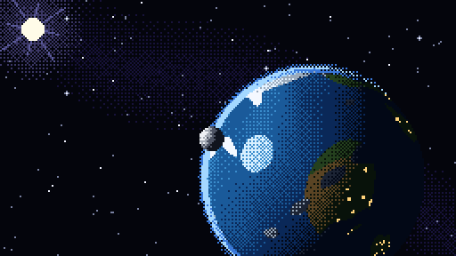

# TV Watch

Tiny videos and pixel-art screensavers on your Apple Watch face, inspired by the
[1982 Seiko TV Watch](https://museum.seiko.co.jp/en/collections/watch_latestage/collect040/).

[Website](https://apps.grokked.it/tv-watch/) · [App Store](https://apps.apple.com/app/id6814760613) · [MIT license](LICENSE)



*Orbita in the 1.2 development version. This is the animation itself, not a recording of a physical Watch.*

## How it works

WidgetKit does not provide a video player or a continuous animation loop for
complications. It can, however, display timer text that the system updates even
when the widget extension is not running.

TV Watch stacks opaque image frames and masks each one with timer text drawn
using a bundled custom font. The font turns the timer into a solid rectangle or
an empty glyph, revealing frames in sequence. Staggering the timers by half a
second targets 2 fps: their one-second visibility windows overlap, with newer
opaque frames on top. It does not require a WidgetKit timeline entry per frame.

The renderer is in [StackedVideo.swift](WatchTV/Shared/StackedVideo.swift); the font
generator is [generate_timer_fonts.py](scripts/generate_timer_fonts.py).
watchOS still controls redraw timing, widget refreshes and Always-On behaviour.
The new 2 fps path has rendering and conversion tests; its cadence and battery
impact on a physical Watch have not been verified.

## What you can do

- Play a video in a compatible rectangular complication, or split it across the
  two rectangular slots of **Modular Duo** using **Top video** and **Bottom video**.
- Choose a clip from Photos or Files on your iPhone, convert it locally and send
  it to your paired Watch. One video is active at a time; a new transfer replaces it.
- Import in **Seiko** mode (128×72 pixels, eight shades of grey) or **Color** mode
  (256×144 pixels, sRGB). Playback is silent; shorter clips repeat and aspect ratio
  is preserved with letterboxing when needed.
- Switch back to an included animation on the Watch. The app and complications
  support English and Italian.

**App Store: 1.1 (24).** Includes Orbita, Gears, Tennis, Pong and Aquarium, with
30-second loops at 1 fps. The app costs €0.99 in Italy (or local equivalent), once;
personal video conversion and transfer are included. No in-app purchases,
subscriptions, ads or account.

**This checkout: 1.2 (29).** Adds imports up to 60 seconds at a target 2 fps and
redesigned screensavers in colour and monochrome: Castaway, Orbita, Aquarium,
Gears and 3D Maze. Castaway has twelve 30-second episodes. The Watch app changes
episodes every 30 seconds; complications request a new episode every 15 minutes,
subject to watchOS scheduling. This version is on TestFlight, not the App Store.

Conversion and storage stay on your devices. Videos are transferred to the paired
Watch, not uploaded to a developer-operated server. The app adds complications
to existing watch faces; it does not install a new watch face or stream television.

## Build

Requires macOS, Xcode with iOS/watchOS SDKs (tested with Xcode 26.6), and deployment
targets iOS 17 and watchOS 10. Fonts, icons and animation packages are included;
Python and ffmpeg are only needed to regenerate assets.

The legacy 30-frame renderer currently uses the private `1fps-widget` 0.1.0 Swift
package. Building this checkout requires access to that dependency.

Open `WatchTV/WatchTV.xcodeproj` and select the **FontTV** scheme. `FontTV` is a
legacy internal build name; the product name is **TV Watch**. The repository URL
remains `apple-watch-tv` to preserve existing links; the current App Store listing
is titled **TV Watch S**.

```sh
xcodebuild build -project WatchTV/WatchTV.xcodeproj -scheme FontTV \
  -configuration Release -destination 'generic/platform=iOS' \
  -derivedDataPath distribution/DerivedData CODE_SIGNING_ALLOWED=NO
```

For a device build, create `WatchTV/Signing.local.xcconfig` with
`DEVELOPMENT_TEAM = YOUR_TEAM_ID`. This file is ignored by Git. Configure bundle
identifiers and an App Group belonging to your team, keeping them consistent
across the three targets, their entitlements and `ImportedVideo.swift`.

Archives, signing credentials, provisioning profiles and personal Xcode settings
are excluded from this repository.

## Regenerate assets

```sh
uv sync --dev
uv run python scripts/generate_default_video.py   # original Orbita and legacy fonts; needs ffmpeg
uv run python scripts/generate_timer_fonts.py    # fixed 30/60-second timer masks
uv run python scripts/generate_included_videos.py # included animations and previews; needs ffmpeg
```

`make_icon.py` generates the app icons. Older video packages retain their original
timing and remain supported; new imports contain 120 PNG frames for a 60-second loop.

## License and credits

The timer-and-font animation technique predates TV Watch. See Bryce Bostwick's
[WidgetAnimation](https://github.com/brycebostwick/WidgetAnimation) and
[Apple's Widget Backdoor](https://bryce.co/widget-animations/), including the use
of staggered timers for sub-second frames. An Apple engineer also suggested
custom glyphs with a SwiftUI timer in a
[2023 developer-forum answer](https://developer.apple.com/forums/thread/720640?answerId=744938022#744938022).
TV Watch applies the idea to watchOS complications and user-selected videos.

The code is available under the [MIT license](LICENSE).
The original included animation content is dedicated to the public domain under
[CC0 1.0](https://creativecommons.org/publicdomain/zero/1.0/); see [asset provenance](ASSETS.md).
Dependencies retain their own licenses.

TV Watch is an independent project, not affiliated with or endorsed by Seiko or Apple.
